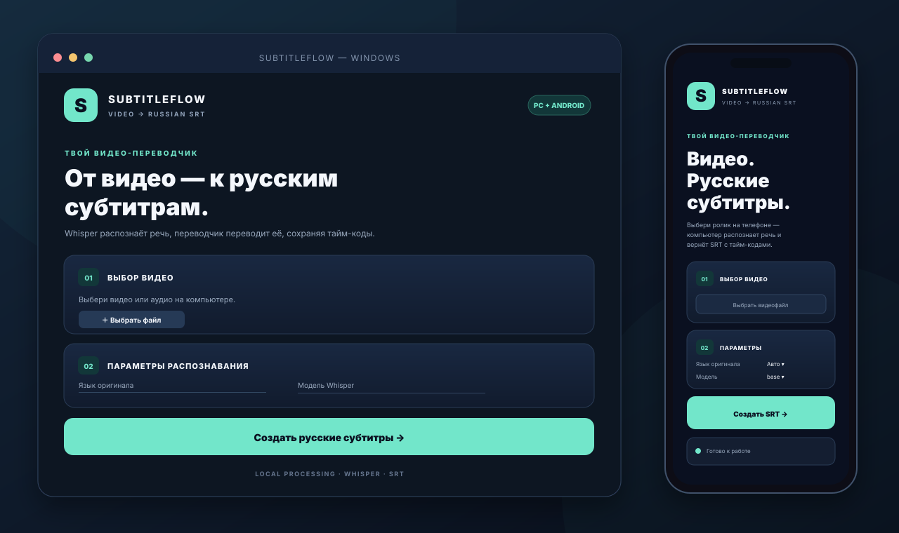

# SubtitleFlow

**SubtitleFlow превращает видео и аудио в русские субтитры `.srt` с тайм-кодами.**

Windows-приложение использует [OpenAI Whisper](https://github.com/openai/whisper) для распознавания речи и Google Translate через `deep-translator` для перевода сегментов на русский. Android-клиент передаёт медиафайл на Windows-компьютер по локальной Wi-Fi сети; обработка выполняется на ПК.



[Логотип проекта](assets/logo.svg)

## Как это работает

1. Выбери видео или аудио на Windows или отправь видео с Android.
2. Whisper распознает речь и сформирует сегменты с временными метками.
3. Переводчик преобразует текст сегментов на русский.
4. SubtitleFlow сохранит файл `имя_видео_ru.srt`.

> **Важно:** Android-приложение не запускает Whisper на телефоне. Компьютер должен быть включён, SubtitleFlow запущен, а оба устройства должны находиться в одной доверенной Wi-Fi сети.

## Возможности

- Графический интерфейс Windows на Python/Tkinter.
- Нативное Android-приложение на Java.
- Мобильная веб-страница, открываемая в Chrome на Android без установки APK.
- Автоопределение языка или ручной выбор языка оригинала.
- Модели Whisper `base` и `small`.
- Сохранение тайм-кодов и кодировки UTF-8 в SRT.
- Временный случайный ключ доступа для локального сервера.
- Поддержка видео: MP4, MOV, MKV, AVI, WEBM, M4V.
- Поддержка аудио на ПК: MP3, WAV, M4A, FLAC.

## Требования

### Windows

- Windows 10/11 x64.
- Python 3.11.
- FFmpeg, доступный из `PATH` (`ffmpeg -version` должен работать в CMD).
- Интернет для первоначальной загрузки модели Whisper и онлайн-перевода.

### Android

- Android 10 (API 29) или новее.
- Для нативной сборки: Android Studio, JDK 17 и Android SDK Platform 35.
- Для работы телефона и ПК — одна доверенная частная Wi-Fi сеть.

## Быстрый запуск на Windows

1. Установи Python 3.11 и FFmpeg, если они ещё не установлены.
2. Скачай ZIP репозитория с GitHub и распакуй его.
3. Открой папку `pc`.
4. Дважды запусти `setup_windows.bat` — скрипт установит Whisper и переводчик.
5. Дважды запусти `start_subtitleflow.bat`.

Программа откроет окно SubtitleFlow. Нажми **«Выбрать файл»**, выбери медиафайл, укажи язык и модель, затем нажми **«Создать русские субтитры»**. Готовый SRT будет сохранён рядом с исходным файлом.

### Запуск через командную строку

Из корневой папки проекта:

```bat
cd pc
setup_windows.bat
start_subtitleflow.bat
```

## Использование на Android

### Вариант A — Chrome, без APK

1. Запусти SubtitleFlow на ПК.
2. Подключи телефон и компьютер к одной доверенной Wi-Fi сети.
3. Скопируй **полный адрес** из раздела «Подключение Android» в окне Windows, включая `?key=...`.
4. Открой этот адрес в Chrome на Android.
5. Выбери видео, язык и модель, нажми **«Создать русские субтитры»**.
6. Скачай результат `.srt` на телефон.

Можно добавить страницу на главный экран Chrome через меню браузера. Это ярлык мобильной веб-страницы, а не отдельный APK.

### Вариант B — нативное Android-приложение

Исходный проект Android находится в каталоге [`android/`](android/). Инструкция по сборке APK: [`android/README_BUILD_APK_RU.md`](android/README_BUILD_APK_RU.md).

Готовый APK в исходный репозиторий не включён. Его можно собрать в Android Studio; после публикации репозитория GitHub Actions также будет собирать debug APK и прикладывать его как артефакт workflow. Нативное приложение позволяет подключиться к серверу на ПК, выбрать видео и сохранить SRT в папку «Загрузки».

## Перевод и качество

Whisper распознаёт речь и формирует временные сегменты. Текст каждого сегмента отправляется внешнему сервису Google Translate через `deep-translator`. Сам исходный видеофайл в Google Translate не отправляется.

Машинный перевод может ошибаться в именах, сленге, шутках, песнях и при плохом качестве звука. Перед публикацией проверь субтитры вручную. При временной ошибке сервиса перевода конкретный сегмент может остаться на языке оригинала; приложение покажет число ошибок.

## Безопасность и приватность

- Сервер доступен в локальной сети на порту `8765`.
- При каждом запуске создаётся случайный временный ключ доступа.
- Ключ не выводится в access-log консоли.
- Файл, отправленный с телефона, временно сохраняется на ПК и удаляется после ответа сервера.
- Используй SubtitleFlow только в доверенной частной Wi-Fi сети.
- Не публикуй URL с `?key=...`, не пересылай его посторонним.
- Не открывай порт `8765` в интернет и не настраивай проброс порта на роутере.
- Соединение по локальному HTTP не шифруется. В недоверенной сети ключ и данные могут быть перехвачены.

Подробности: [`SECURITY.md`](SECURITY.md).

## Структура проекта

```text
SubtitleFlow/
├── .github/workflows/     # автоматические проверки
├── android/               # исходники Android-приложения
├── assets/                # логотип и превью интерфейса
├── pc/                    # Windows UI, движок Whisper и LAN-сервер
├── tests/                 # модульные тесты
├── CHANGELOG.md
├── CONTRIBUTING.md
├── LICENSE
├── README.md
└── SECURITY.md
```

## Проверки проекта

Для быстрой проверки Python-части (Python 3.11+):

```bash
python -m compileall -q pc tests
python -m unittest discover -s tests -v
```

Эти проверки не запускают Whisper на реальном видео и не собирают APK. Полную обработку нужно проверить на Windows с установленным FFmpeg и зависимостями; сборку Android — в Android Studio.

## Публикация на GitHub

Инструкция для первого размещения проекта в собственном аккаунте: [`PUBLISH_TO_GITHUB_RU.md`](PUBLISH_TO_GITHUB_RU.md).

## Участие в разработке

См. [`CONTRIBUTING.md`](CONTRIBUTING.md).

## Лицензия

MIT. См. [`LICENSE`](LICENSE). Whisper, PyTorch и остальные зависимости распространяются по собственным лицензиям.
